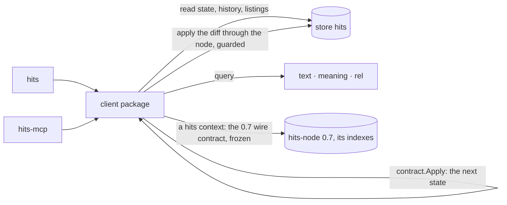

# The client

How HITS reads and writes its store, and what the two surfaces on it keep:
one `client` package on chronicle's Go client, the CLI's sentences and the
MCP server's tools unchanged above it, chronicle's contexts underneath.
Settled by decision [0021](../03-DECISIONS/0021-the-client-one-package-on-chronicle-the-sentences-and-the-tools-unchanged-contexts-are-chronicles.md);
the store it speaks to is [`the-store.md`](the-store.md), the model it
enforces is [`item-model.md`](item-model.md). This document replaces
[`services.md`](services.md) (the fleet is gone), [`hits-up.md`](hits-up.md)
(nothing runs) and [`idp-auth.md`](idp-auth.md) (the connection is
chronicle's); [`mcp-server.md`](mcp-server.md) stands, amended.

**Amended by [0023](../03-DECISIONS/0023-the-client-speaks-two-substrates-chronicle-and-the-0-7-fleet-frozen-at-its-release-chosen-by-the-context.md)** (2026-10-18): the `client` package is an interface with
two implementations — chronicle's, and the wire contract of the 0.7 fleet
frozen at its release — and the context chooses between them; the actor,
`context`, `auth` and `ping` return for hits contexts. The sections below
carry the amendment where it lands; the fleet implementation is release
0.10.0's build.

## The write loop

Every write of the `client` package is one loop, the same for an item
and for a vocabulary:

1. **Read** the instance's state and the sequence it stands at — and,
   for the rules chronicle cannot judge, the other instances the rule
   names: the project or release `located-in` and `target` point at, the
   initiative a filing mints from, the open items a `ship` must find
   none of.
2. **Check** the command against [`item-model.md`](item-model.md)'s
   invariants with `contract`'s checks — every rule, as `hits-node`
   checked them, so a refusal is the same machine-legible invariant name
   it has always been.
3. **Fold** the next state with `contract.Apply`, the install's own fold.
4. **Send the difference**: every field that changed as its new value,
   every field that was cleared as `null`, as the operation
   [`the-store.md`](the-store.md) names for the command — through
   chronicle's node (a verified author) with the expected sequence read
   in step 1. A `create` carries the whole state with the create-only
   guard; a `note` carries its text.
5. **On a guard miss**, read again and go to step 2: the instance moved
   under the check, as it could under `hits-node`'s CAS, and the retry
   is the same judgement.

Chronicle refuses, before the send, what a precondition or the type's
schema forbids; the client's checks run first and say it in the model's
words, so a user sees `terminal-status`, not a schema's detail. Filing is
two loops: `mint` on the initiative, then `create` on the item.

## Reads

| Sentence | Read |
|---|---|
| `get` | the instance's state, then its history for the notes — each note's author and time are the operation's; `--revisions` is the state's per-key history, as before |
| `project list`, `initiative list`, `release list` | a listing of the type (a release listing under its initiative), retired entries dropped by the client |
| the status view, `search` with filters | a listing of `item` with the client's filter; a search's hits joined with their states and filtered |
| `search`, `semantic` | the `text` and `meaning` indexes' streamed replies; `--limit` caps, there is no page |
| `graph neighbors`, `graph walk` | the `rel` index's two verbs, with direction, labels and depth |
| `audit` | states and histories read through the package, held against git as before — and two reads of its own: the gaps in each initiative's numbering, and the operations after the cutover's sequence whose author chronicle did not vouch for |

Tombstoned items are dropped from every read by the client.

## The connection

`hits` and `hits-mcp` connect through a saved context, loaded by name —
`--context NAME` on every sentence — or the selection. Two families
exist, and the context chooses the substrate (decision [0023](../03-DECISIONS/0023-the-client-speaks-two-substrates-chronicle-and-the-0-7-fleet-frozen-at-its-release-chosen-by-the-context.md)). A
**chronicle context**, dialled as chronicle's own CLI dials it —
`chronicle login` for a sign-in to the hosted account, a credential file
or an nkey for any NATS — reaches the store of this document; the store
is the context's selected store or `hits`. A **hits context** — the
document of [0011](../03-DECISIONS/0011-standalone-hits-contexts.md), a
nats subtree and an oauth block, managed by `hits context` and
`hits auth` as 0.7 had them — reaches a fleet frozen at the v0.7.0
release. A name resolves against chronicle's contexts first, then
hits's; a name both hold is refused as ambiguous; with no name,
chronicle's selection, else hits's default context, else the refusal
that names both ways to get one. The token exchange and its cache
(decisions [0008](../03-DECISIONS/0008-client-idp-auth.md) to 0011) stay
for hits contexts alone; a nats context an operator used to import is
added with `chronicle context add`.

**The actor is the principal on chronicle, and a flag on the fleet.** On
a chronicle context every write's author is who the context connects as
— a person's GitHub login, an agent's service-account name — stamped and
vouched for by chronicle, and an actor named by `--actor` or
`HITS_ACTOR` is refused. On a hits context a write needs one — `--actor`,
`HITS_ACTOR`, the hits config's default, in that order — and the 0.7
node validates it as it always did; `hits-mcp` takes it at startup for a
hits context and refuses it for a chronicle one. One process is one
context, and a chronicle context is somebody.

## The sentences

Unchanged: every item verb, the three vocabularies, `search`, `semantic`,
`graph`, `audit`, `version`, and every flag of theirs; `--actor` is a
hits context's flag (above). Leaving: `up` (nothing runs —
[`the-cutover.md`](the-cutover.md)). Staying, for hits contexts:
`context` and `auth`. `ping` answers on both substrates — the node's name
and version on the fleet, the store's announcement (`solution/hits`) on
chronicle. Arriving: `store init` ([`the-cutover.md`](the-cutover.md)),
and `migrate`, which stays while a 0.7 fleet exists.
The `hits-cli` skill's item sections stand; its connection and actor
sections are rewritten with the release, through
[playbook 06](../00-META/process/06-builder-skill-sync.md).

## The MCP server

[`mcp-server.md`](mcp-server.md) as amended: one tool per client
method, stdio, fail-fast — resolve the context, dial, read what answers
(the store's types on chronicle, the node's ping on the fleet), then
serve. The tools carry no actor and never did; the startup actor is a
hits context's (decision 0023). Chronicle's own MCP server (chronicle-hq research
013) may one day do what the tools do; until a decision says so,
`hits-mcp` is the agent's door.

## The repository

`cmd/hits` and `cmd/hits-mcp` over `client` — the interface,
`client/chronicle` and `client/fleet` — `contract`, and
`internal/connect` for hits contexts; nothing else. `contract` keeps the
model, the invariants and the fold — `contract.Apply` is what the write
loop folds with. `internal/node`, `internal/index` and `internal/fleet`
left with the four fleet binaries, and the lint rules that fenced the
services from one another with them; the rule that keeps the adapters on
the client stays. The release carries two binaries and the install
manifest. The test harness runs chronicle's quick start and, beside it,
the v0.7.0 fleet built from its tag — the frozen contract the fleet
implementation is proven against.

## What this does not do

No service, no endpoint, no projection of HITS's own; no cache of state
or history in a client. No write that is not the difference the fold
produced. No filter on the wire: chronicle's search is no-knobs and the
client joins. No actor a caller may name on a chronicle context: there
the author is the connection's. No fix to the fleet: a 0.7 install that
needs one moves.
